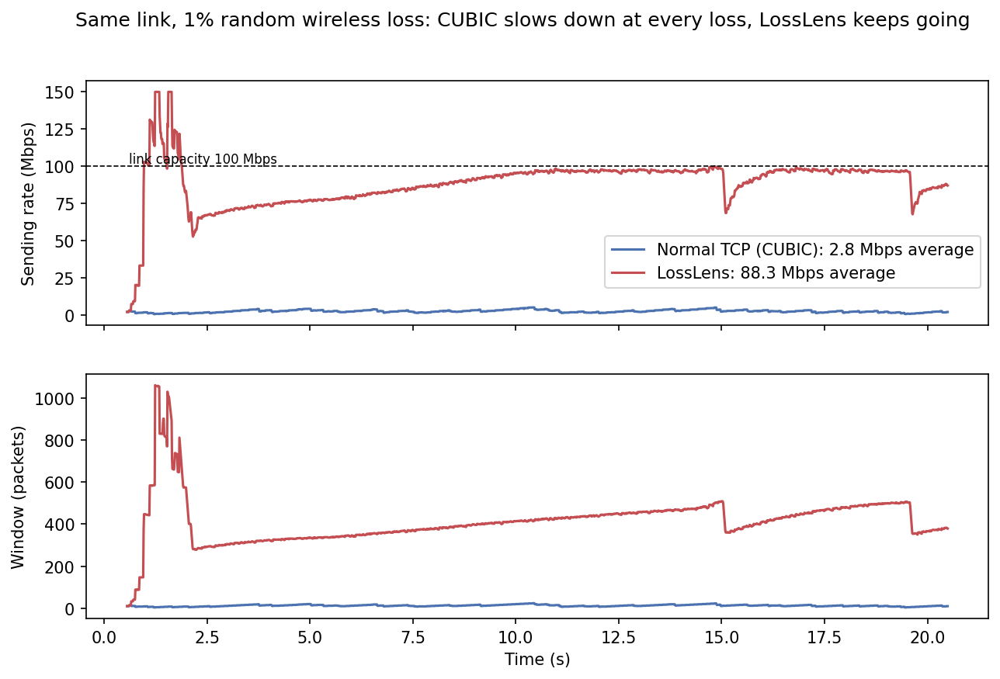

# LossLens
### Learning-Based Loss Differentiation for Adaptive TCP Congestion Control in High-Speed Wireless Networks

*Course project topic: Adaptive Congestion Control for High-Speed Networks*

TCP treats every packet loss as a sign of congestion and cuts its sending window.
On wireless links many losses are caused by interference instead, so TCP slows
down even when the network has spare capacity.

LossLens adds a lightweight classifier inside the TCP sender (in ns-3). At every
loss event it decides whether the loss was caused by **congestion** (reduce the
window, like CUBIC) or was **random** (keep the window).

```
[sender] ──access── [router] ══ bottleneck queue ══ [AP] ~~ lossy wireless hop ~~ [receiver]
   │                    ↑ congestion drops                ↑ random drops
   │               + cross traffic
   └─ TcpLossAware (extends TcpCubic)
        loss detected → compute features → classifier → cut cwnd only if "congestion"
```

The simulator knows exactly why each packet was dropped (queue overflow or
wireless error), which gives us labelled training data for free.

## Results

At 1% random wireless loss on a 100 Mbps link, LossLens is **7× faster than CUBIC at
50 ms RTT and 24× faster at 150 ms**, and it never takes more than CUBIC's share of a
shared link.



| 1% random loss, 100 Mbps link (Mbps) | CUBIC | LossLens (tree) | LossLens (oracle) | Westwood+ | BBR |
|---|---|---|---|---|---|
| Base RTT 50 ms | 3.0 | 21.8 | 31.9 | 37.6 | 70.2 |
| Base RTT 150 ms | 1.2 | 28.4 | 39.0 | 12.9 | 67.0 |

Mean of 3 runs of 30 s, with bursty background traffic using 30% of the link on average.

- **Oracle** (perfect loss classification) brings CUBIC back to its loss-free speed
  (34.6 / 42.3 Mbps); the trained decision tree recovers about 70% of that.
- **Safe and fair:** under pure congestion LossLens behaves exactly like CUBIC, and when it
  shares a link with CUBIC users it takes exactly the same share CUBIC would (1.00 of a
  fair share against one CUBIC flow, 60 s runs, equal start).
- **BBR** is faster here but takes up to 3.9× its fair share from CUBIC users.
- **Limitation:** when other TCP flows keep the bottleneck queue full, the delay clues
  always look like congestion and LossLens falls back to plain CUBIC.

All figures: [`results/plots/`](results/plots/) ·
full table: [`results_table.csv`](results/plots/results_table.csv).

## How it works

| Phase | What was done |
|---|---|
| 1. Simulation | ns-3.49 scenario with a congestible router queue and a lossy wireless hop; every drop is labelled congestion or random |
| 2. Data | 300 runs over link speeds, RTTs, loss rates, buffers and traffic mixes: 36,055 labelled loss events, 7 sender-side features each |
| 3. Classifier | Decision tree (depth 6), threshold tuned on held-out runs for ≥ 90% congestion recall, exported to plain C++ |
| 4. TCP | `TcpLossAware` extends CUBIC: cuts the window only for congestion, keeps growing through random-loss recovery, safety fallback |
| 5. Evaluation | 396 runs against NewReno, CUBIC, Westwood+, Veno and BBR, plus fairness tests against CUBIC users |

Details: [sim/](sim/README.md) · [ml/](ml/README.md) · [tcp/](tcp/README.md) ·
[file formats](docs/interfaces.md).

## Run it

Setup (WSL2, ns-3.49, Python): see [docs/setup.md](docs/setup.md). Then, inside WSL:

```bash
bash scripts/link-into-ns3.sh ~/ns-3
cd ~/ns-3 && ./ns3 build
```

**Live demo:** a new random network each run; normal TCP (before) vs LossLens (after),
then the graph opens:

```bash
bash scripts/demo.sh ~/ns-3
```

**Reproduce the results:**

```bash
python3 sim/run_sweep.py --ns3 ~/ns-3 --preset dataset --sample 300   # training data
python ml/train.py && python ml/export_tree.py                         # train + export tree
bash scripts/run-eval.sh ~/ns-3                                        # rebuild + evaluation runs
python eval/plot_results.py                                            # figures + table
```

## Repository layout

```
common/   Shared C++: feature extractor, simulator ground truth
sim/      ns-3 scenario, drop labelling, experiment sweeps
ml/       Dataset loading, training, export of the tree to C++
tcp/      TcpLossAware congestion control + generated classifier
eval/     Plots, results table, demo graph
scripts/  Setup, demo and evaluation scripts
docs/     Setup guide and the file formats between components
report/   Report outline
results/  Final figures in results/plots/ (raw run outputs are git-ignored)
data/     Training data written by the simulator (git-ignored)
```

## Team

| Member | Role | Responsible for |
|---|---|---|
| **Member 1**: [@ShreyaShirsh](https://github.com/ShreyaShirsh) | Development | All code: simulation, ML, TCP, experiments, plots |
| **Member 2**: Avani Abhay Chaudhary | Documentation | Literature review, introduction, related work, simulation setup and classifier chapters |
| **Member 3**: Arpita Sinha | Documentation | Design chapter, results write-up, diagrams, slides, final formatting |
